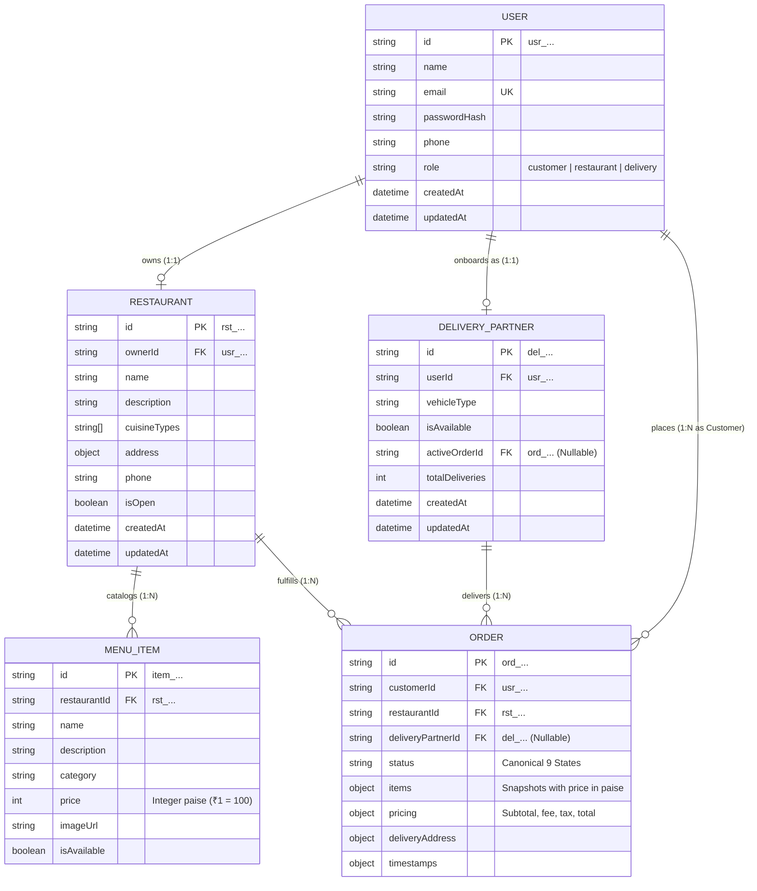
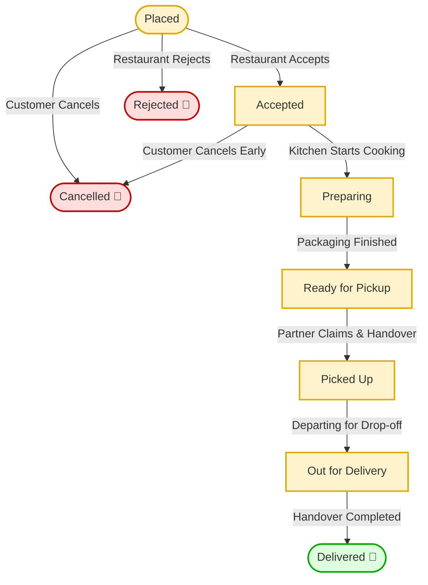

# Appendix C: Data Model & Order Lifecycle Specification

**Course / Evaluation:** Continuous Evaluation 1 (CE-1) Progress Review
**Project Title:** Zaykaa — Multi-Sided Food Delivery Platform
**Sources of Truth:** [docs/data-models.md](file:///Users/tarshitgupta/Coding%20&%20Projects/Projects/Zaykaa/docs/data-models.md), [docs/order-lifecycle.md](file:///Users/tarshitgupta/Coding%20&%20Projects/Projects/Zaykaa/docs/order-lifecycle.md), and [backend/src/modules/orders/order.service.js](file:///Users/tarshitgupta/Coding%20&%20Projects/Projects/Zaykaa/backend/src/modules/orders/order.service.js)

---

## C1. Canonical Data Models

| Entity Name | Primary Key Prefix | Key Fields & Data Types | Relationships | Critical Validation Constraints |
|---|---|---|---|---|
| **User** (`users.json`) | `usr_<id>` | `name` (String, 2-80 chars) `email` (String, unique) `passwordHash` (String, bcrypt) `phone` (String, 10-15 chars) `role` (String Enum) `createdAt`, `updatedAt` (ISO UTC) | Parent to Restaurant (`ownerId`) or Delivery Partner (`userId`); Customer in Order (`customerId`). | Single role assignment (`customer`, `restaurant`, or `delivery`). Password hash never exposed in API. |
| **Restaurant** (`restaurants.json`) | `rst_<id>` | `ownerId` (String FK) `name` (String, 2-100 chars) `description` (String) `cuisineTypes` (Array of Strings) `address` (Object: street, city, pincode) `phone` (String) `isOpen` (Boolean) `createdAt`, `updatedAt` (ISO UTC) | Belongs to User (`ownerId`). Parent to Menu Items (`restaurantId`) and Orders (`restaurantId`). | Exactly one restaurant per user with role `restaurant`. Protected fields (`id`, `ownerId`) immutable. |
| **Menu Item** (`menus.json`) | `item_<id>` | `restaurantId` (String FK) `name` (String, 2-100 chars) `description` (String) `category` (String Enum) `price` (Integer paise) `imageUrl` (String URL) `isAvailable` (Boolean) | Belongs to Restaurant (`restaurantId`). Referenced in Order `items[].itemId`. | Monetary values strictly positive integers in paise (e.g. ₹150 = `15000`). Float values rejected. |
| **Order** (`orders.json`) | `ord_<id>` | `customerId` (String FK) `restaurantId` (String FK) `deliveryPartnerId` (String FK, nullable) `status` (String Enum: 9 canonical states) `items` (Array of item snapshots) `pricing` (Object: subtotal, deliveryFee, tax, total in paise) `deliveryAddress` (Object) `timestamps` (Object of ISO UTC dates) | Belongs to Customer (`customerId`), Restaurant (`restaurantId`), and Delivery Partner (`deliveryPartnerId`). | Items must come from single restaurant. Status follows atomic transition state machine. Terminal states immutable. |
| **Delivery Partner** (`delivery_partners.json`) | `del_<id>` | `userId` (String FK) `vehicleType` (String Enum: Motorcycle, Bicycle, EV, Scooter) `isAvailable` (Boolean duty status) `activeOrderId` (String FK, nullable) `totalDeliveries` (Integer counter) `createdAt`, `updatedAt` (ISO UTC) | Belongs to User (`userId`). Linked to currently assigned Order (`activeOrderId`). | Exactly one partner profile per `delivery` user. **One-active-order invariant:** `activeOrderId` must be `null` before claiming a new task. |

---

## C2. Entity Relationship Diagram (ERD)

---

## C3. Canonical Order Lifecycle State Machine

---

## C4. State Transition Matrix & Implemented API Endpoints

| Current Status | Allowed Next Status | Responsible Role | Implementation Status | Implemented API Action |
|---|---|---|:---:|---|
| *(New Order)* | `Placed` | `customer` | **Planned (M1)** | `POST /api/orders` (Simulated via localStorage cart in CE-1) |
| `Placed` | `Accepted` | `restaurant` | **Implemented** | `PATCH /api/orders/:id/status` `{ "status": "Accepted" }` |
| `Placed` | `Rejected` | `restaurant` | **Implemented** | `PATCH /api/orders/:id/status` `{ "status": "Rejected" }` *(Terminal)* |
| `Placed` | `Cancelled` | `customer` | **Planned (M1)** | `POST /api/orders/:id/cancel` *(Terminal)* |
| `Accepted` | `Preparing` | `restaurant` | **Implemented** | `PATCH /api/orders/:id/status` `{ "status": "Preparing" }` |
| `Accepted` | `Cancelled` | `customer` | **Planned (M1)** | `POST /api/orders/:id/cancel` *(Terminal; forbidden once cooking starts)* |
| `Preparing` | `Ready for Pickup` | `restaurant` | **Implemented** | `PATCH /api/orders/:id/status` `{ "status": "Ready for Pickup" }` |
| `Ready for Pickup` | *(Assignment)* | `delivery` | **Implemented** | `PATCH /api/partners/orders/:id/accept` *(Sets `deliveryPartnerId`)* |
| `Ready for Pickup` | `Picked Up` | `delivery` | **Implemented** | `PATCH /api/partners/orders/:id/pickup` |
| `Picked Up` | `Out for Delivery` | `delivery` | **Implemented** | `PATCH /api/partners/orders/:id/out-for-delivery` |
| `Out for Delivery` | `Delivered` | `delivery` | **Implemented** | `PATCH /api/partners/orders/:id/deliver` *(Terminal; increments courier trips)* |
